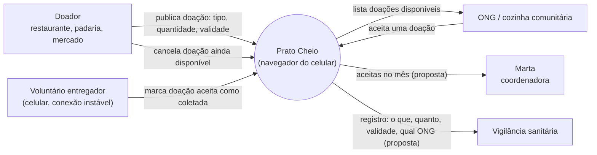

**Pergunta:** quem troca o que com o Prato Cheio, e quem fica de fora do sistema?

**Decisão que sustenta:** D4 (ciclo de vida da doação) e D5 (uma página web para o celular) em `docs/projeto.md`.

**Situação:** retrato da `main` no commit `6a04804`; setas marcadas *(proposta)* ainda não existem no código.

# Diagrama de contexto — Prato Cheio

6 elementos. O banco não aparece porque é parte do sistema, não ator externo.
O WhatsApp, que hoje faz a articulação, fica fora de propósito: o piloto não se
integra a ele (restrição "sem integração").
