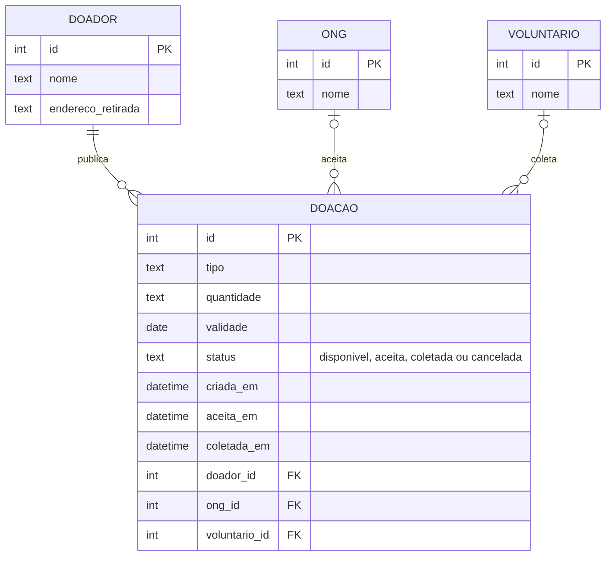

**Pergunta:** que dados o piloto precisa guardar para saber o que foi doado, por quem, para quem e quando?

**Decisão que sustenta:** D4 (ciclo de vida da doação) e ADR 0001 (o mesmo modelo vai para o PostgreSQL).

**Situação:** proposta — modelo-alvo. O que existe hoje está em `src/db.js` no commit `7dcff13`; as diferenças estão em `docs/projeto.md`, `## Diagramas`.

# Diagrama de dados — Prato Cheio

4 entidades. Regras que o desenho carrega:
- uma doação tem no máximo uma ONG (`|o`), coerente com "aceita não fica disponível para outra";
- `status` só avança: `disponivel → aceita → coletada` ou `disponivel → cancelada`;
- cada avanço tem a sua data, para medir o tempo entre "disponível" e "coletada".
